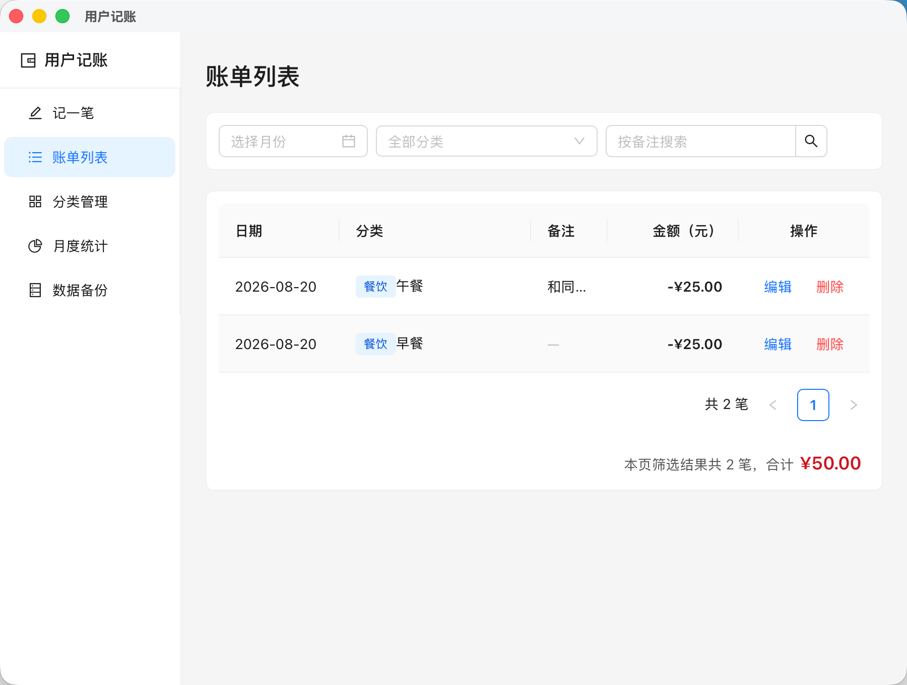
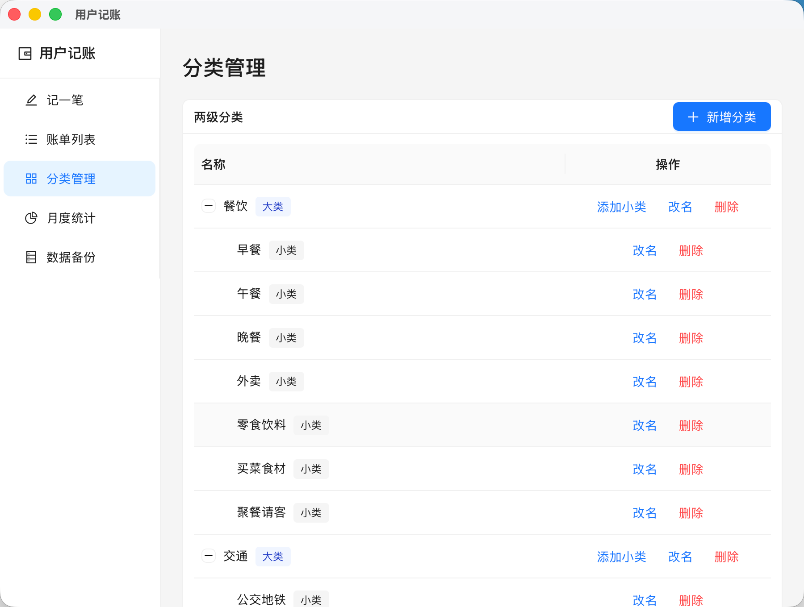
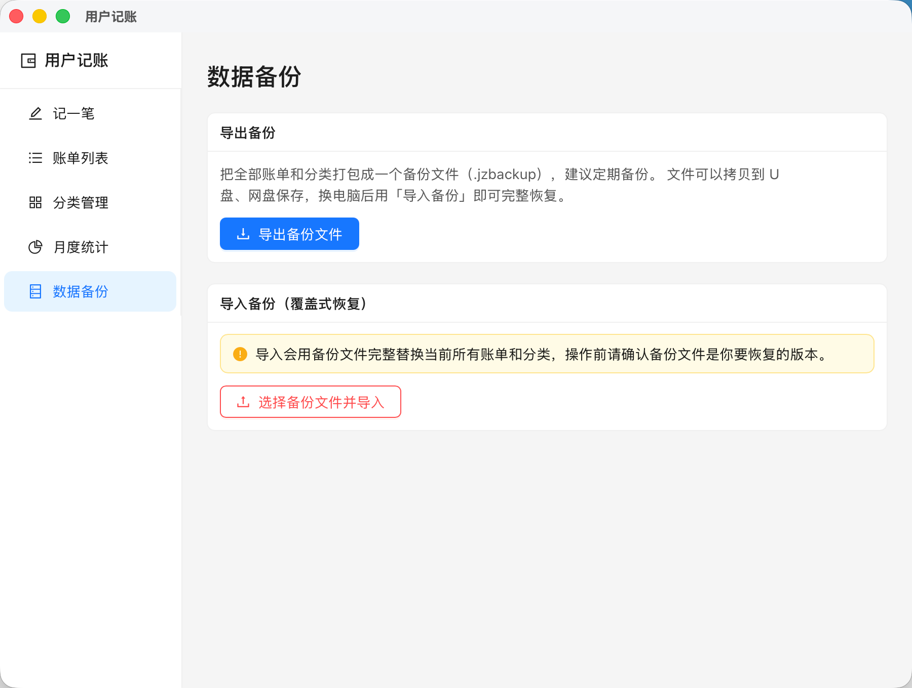

# 用户记账

轻量、完全离线的跨平台桌面记账应用（Windows / macOS）。支持两级分类管理、账单筛选、月度消费统计与数据备份恢复。**所有数据只保存在本机 SQLite 数据库中，不上传任何服务器。**

## 功能

- **记一笔花销**：金额精确到分，日期默认当天可修改，备注选填
- **两级分类**：内置 11 个一级大类、50+ 二级小类（餐饮、交通、购物、居住、娱乐……），支持自定义增删改；删除被账单使用的分类会提示保护，防止误删历史数据
- **账单列表**：按日期倒序展示，支持按月份、分类（选大类自动包含其全部小类）、备注关键字筛选
- **编辑与删除**：任意记录可修改，删除需二次确认
- **月度统计**：每月总支出、各大类支出金额与占比（ECharts 图表），点击大类可下钻查看二级小类明细
- **数据备份**：一键导出 `.jzbackup` 备份文件，导入时先校验文件有效性再覆盖式恢复，换电脑不丢数据

## 界面截图

| 账单列表 | 记一笔花销 |
|:---:|:---:|
|  |  |

| 分类管理 | 月度统计 |
|:---:|:---:|
|  |  |

| 数据备份 |
|:---:|
|  |

## 技术栈

| 层 | 技术 |
|---|---|
| 桌面框架 | Tauri 2（Rust） |
| 前端 | React 19 + TypeScript + Vite 7 |
| UI 组件 | Ant Design 6 |
| 图表 | ECharts |
| 数据存储 | SQLite（rusqlite，数据库引擎随应用打包，用户无需安装任何数据库） |
| 打包发布 | GitHub Actions 自动构建 Windows（NSIS）安装包 |

## 架构设计

- 前端通过 Tauri `invoke` 调用 Rust 命令层（`#[tauri::command]`），共 11 个命令覆盖账单、分类、统计、备份全部业务
- 金额以「分」为整数单位存储（`amount_cents`），从源头避免浮点运算误差
- 数据库连接以 `Mutex` 保护多线程安全；导入备份采用「临时文件 + rename」原子替换，避免中断导致数据损坏
- 导出备份使用 SQLite `VACUUM INTO` 生成干净一致的数据库副本
- 内置默认分类仅在首次运行时写入，已有数据时自动跳过

## 本地运行

前置要求：Node.js 20+、Rust（stable）

```bash
npm install
npm run tauri dev    # 开发模式
npm run tauri build  # 打包当前平台安装包
```

## 打包发布

- **Windows**：推送代码到 `main` 分支自动触发 [GitHub Actions](.github/workflows/build-windows.yml)，构建 NSIS 安装包（构建产物在 Actions 页面下载）
- **macOS**：本地执行 `npm run tauri build` 生成 `.dmg`

## 后续计划

- 收入记录（当前版本只记支出）
- 每月预算与超支提醒
- 多设备云同步
